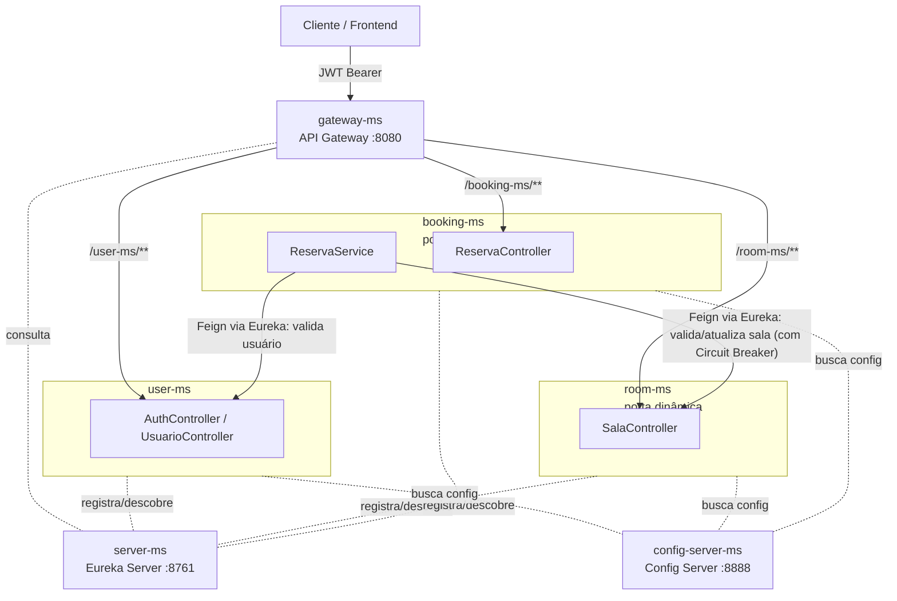
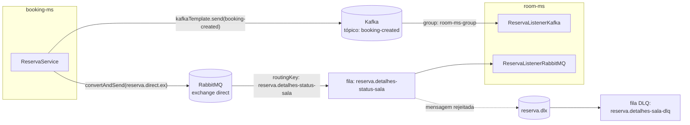

# Room Reservation API — Microservices

Evolução do projeto [room-reservation-api](https://github.com/jhohannessf/room-reservation-api) (originalmente um monolito) para uma **arquitetura de microsserviços**, com **Service Discovery (Eureka)**, **API Gateway**, **configuração centralizada (Spring Cloud Config)**, **resiliência com Circuit Breaker**, comunicação síncrona via **OpenFeign**, **mensageria assíncrona (Kafka e RabbitMQ)**, autenticação **stateless com JWT**, **login social (Google e GitHub)**, **autenticação de dois fatores (2FA)** por e-mail ou aplicativo autenticador (TOTP), **documentação interativa da API (Swagger/OpenAPI)** e **testes automatizados** (JUnit 5, Mockito, MockMvc e Testcontainers).

> 📌 Este repositório é a continuação do projeto monolítico citado acima. Aqui a mesma regra de negócio (gestão de usuários, salas e reservas) foi redesenhada como um sistema distribuído.

## Sumário

- [Sobre o projeto](#sobre-o-projeto)
- [Arquitetura](#arquitetura)
- [Stack técnica](#stack-técnica)
- [Estrutura do repositório](#estrutura-do-repositório)
- [Segurança](#segurança)
- [Resiliência](#resiliência)
- [Mensageria](#mensageria)
- [Serviços e endpoints](#serviços-e-endpoints)
- [Documentação da API (Swagger)](#documentação-da-api-swagger)
- [Testes](#testes)
- [Modelagem de dados](#modelagem-de-dados)
- [Como rodar o projeto](#como-rodar-o-projeto)
- [Roadmap](#roadmap)

## Sobre o projeto

- **Continuação do monólito:** este repositório evolui o [room-reservation-api](https://github.com/jhohannessf/room-reservation-api), construído antes como aplicação única, para uma arquitetura de microsserviços.
- **Desafio 2 da Alura:** o projeto também foi desenvolvido como o **Desafio 2 da Alura**.
- **Projeto de estudo e portfólio:** para um domínio tão pequeno, um monólito bastaria. A arquitetura distribuída foi escolhida de propósito, para praticar descoberta de serviços, configuração centralizada, resiliência e mensageria.
- **Uso de IA (transparência):** o autor usou um chat de IA como apoio durante o desenvolvimento: para tirar dúvidas, na construção do projeto e na montagem deste `README.md`.

## Arquitetura

O sistema é composto por 6 aplicações Spring Boot: três microsserviços de negócio (cada um com seu próprio banco de dados, padrão *Database per Service*), um servidor de descoberta de serviços, um servidor de configuração centralizada e um API Gateway como porta de entrada única. Além deles, o `docker-compose.yml` também sobe a infraestrutura de mensageria (RabbitMQ e Kafka) usada por `booking-ms` e `room-ms` — ver seção [Mensageria](#mensageria).

| Serviço | Responsabilidade | Porta |
|---|---|---|
| `server-ms` | Eureka Server — registro e descoberta de serviços | `8761` (fixa) |
| `config-server-ms` | Spring Cloud Config Server — configuração centralizada dos serviços de negócio | `8888` (fixa) |
| `gateway-ms` | API Gateway — ponto único de entrada, roteamento dinâmico via Eureka | `8080` (fixa) |
| `user-ms` | Cadastro de usuários, autenticação, login social, 2FA | dinâmica (`server.port=0`) |
| `room-ms` | Cadastro e controle de status das salas, consumidor Kafka/RabbitMQ | dinâmica (`server.port=0`) |
| `booking-ms` | Regras de reserva, orquestração via Feign, resiliência com Circuit Breaker, produtor Kafka/RabbitMQ | dinâmica (`server.port=0`) |

> Os três serviços de negócio usam `server.port=0`: o Spring Boot pede uma porta livre ao sistema operacional a cada subida, e cada instância se registra no Eureka com um `instance-id` único (`${spring.application.name}:${random.int}`). Isso permite subir **mais de uma instância do mesmo serviço** (ex: dois `room-ms` em paralelo) sem conflito de porta, com o `gateway-ms` e os `@FeignClient` fazendo *load balancing* entre elas via Eureka — o cliente nunca precisa saber a porta real, só acessa tudo por `http://localhost:8080/<nome-do-serviço>/...`.



Como funciona na prática:

- **`server-ms`** é o Eureka Server: cada um dos outros serviços se registra nele ao subir, e é através dele que se descobrem uns aos outros (em vez de URLs fixas).
- **`config-server-ms`** centraliza o `application.properties` de `user-ms`, `room-ms` e `booking-ms` — em vez de cada um carregar sua própria configuração local, eles importam de `http://localhost:8888` na inicialização (`spring.config.import=optional:configserver:...`). Os arquivos de configuração reais ficam empacotados no classpath do próprio Config Server, em `config-server-ms/src/main/resources/config-repo/` — uma escolha deliberada para não depender de um caminho absoluto no disco (ver [Roadmap](#roadmap) para o histórico dessa decisão).

  **Por que centralizar configuração?** Antes dele, cada serviço tinha seu próprio `application.properties` completo (URL do banco, chave JWT, credenciais de e-mail etc.), espalhados em arquivos diferentes. Numa arquitetura de microsserviços de verdade, isso vira um problema de escala: imagine ter várias instâncias de `user-ms` rodando e precisar mudar um único valor — sem Config Server, seria necessário alterar e reiniciar cada instância manualmente. Com a configuração centralizada, a mudança é feita em um único lugar (`config-repo/user-ms.properties`), e qualquer instância que reiniciar já busca o valor atualizado — a fonte da verdade da configuração fica desacoplada do deploy de cada serviço.

  Neste projeto ele roda no **modo "native"**, lendo arquivos `.properties` locais (empacotados no próprio jar) em vez de buscar de um repositório Git remoto, que é o modo mais comum em produção — uma simplificação razoável para fins de portfólio, que ainda demonstra o entendimento do conceito de configuração centralizada sem exigir manter um repositório Git separado só para isso.
- **`gateway-ms`** é o único serviço com porta exposta que faz sentido o cliente conhecer. Ele recebe a requisição, olha o prefixo do path (`/user-ms/**`, `/room-ms/**` ou `/booking-ms/**`), remove esse prefixo (`StripPrefix=1`) e encaminha para uma instância saudável do serviço correspondente, resolvida dinamicamente via Eureka (`lb://user-ms`, por exemplo).
- **`booking-ms`** continua sendo o orquestrador da regra de negócio: antes de confirmar uma reserva, ele consulta `user-ms` e `room-ms` via **Feign Clients**, resolvidos via Eureka. Essas chamadas são protegidas por **Circuit Breaker** (ver seção [Resiliência](#resiliência)); paralelamente, ele também publica eventos assíncronos para `room-ms` via **Kafka** e **RabbitMQ** (ver seção [Mensageria](#mensageria)).
- Assim como antes, cada serviço valida o JWT **localmente**, sem precisar chamar `user-ms` a cada requisição — os serviços compartilham a mesma chave secreta (`jwt.key`).
- Como `user-ms`, `room-ms` e `booking-ms` rodam em porta dinâmica, o endpoint `GET /api/v1/reservas/porta` existe justamente para comprovar o *load balancing* na prática: ele devolve a porta local (`${local.server.port}`) da instância de `booking-ms` que respondeu — útil para chamar repetidamente e ver a porta mudar entre instâncias diferentes.

## Stack técnica

- **Java 21** + **Spring Boot** (multi-módulo Maven, com um `pom.xml` raiz agregando os 6 serviços)
- **Spring Cloud Netflix Eureka** — service discovery (server e client)
- **Spring Cloud Config** — configuração centralizada (modo *native*, lendo do classpath)
- **Spring Cloud Gateway (MVC)** — API Gateway com roteamento declarativo
- **Spring Cloud OpenFeign** + **Spring Cloud LoadBalancer** — comunicação HTTP síncrona entre `booking-ms` e os demais serviços, com resolução de endereço via Eureka
- **Resilience4j (Spring Cloud Circuit Breaker)** — tolerância a falhas nas chamadas Feign de `booking-ms`
- **Spring Boot Actuator** — `/actuator/health` e `/actuator/circuitbreakers` em `booking-ms`, para acompanhar o estado do Circuit Breaker
- **Spring `@Scheduled`** — job de reconciliação para reservas pendentes de integração
- **Apache Kafka (Spring Kafka)** — mensageria assíncrona orientada a evento (`booking-created`), com DTOs próprios por serviço
- **RabbitMQ (Spring AMQP)** — mensageria com exchanges/filas/DLQ para notificação de mudança de status de sala
- **Spring Data JPA / Hibernate** — persistência
- **Flyway** — versionamento de schema (MySQL)
- **Spring Security** — autenticação e autorização
- **JJWT + Auth0 java-jwt** — geração e validação de JWT
- **Spring Security OAuth2 Client** — login social (Google e GitHub)
- **GoogleAuth (warrenstrange)** — geração/validação de códigos TOTP (Google Authenticator)
- **Spring Mail** — envio de código de 2FA por e-mail
- **MySQL** — um banco por serviço de negócio
- **Docker Compose** — sobe os 6 serviços de aplicação + MySQL + RabbitMQ + Kafka + Kafka UI com um único comando
- **Bean Validation (Jakarta Validation)**
- **springdoc-openapi** — documentação OpenAPI 3 e Swagger UI em `user-ms`, `room-ms` e `booking-ms`
- **JUnit 5 + Mockito + AssertJ** — testes unitários das camadas de serviço e de mapeamento
- **Spring MockMvc (`@WebMvcTest`)** — testes da camada web: status HTTP, validação do corpo e regras de autorização por perfil, sem subir banco nem brokers
- **Testcontainers** (MySQL, RabbitMQ e Kafka) + **Awaitility** — testes de integração em `booking-ms` e `room-ms`

## Estrutura do repositório

Monorepo multi-módulo: um `pom.xml` raiz agrega os 6 serviços, cada um com seu próprio `pom.xml`, `Dockerfile` e ciclo de vida independente.

```
room-reservation-api-microservice/
├── pom.xml                        # POM agregador (packaging pom)
├── docker-compose.yml             # app services + MySQL + RabbitMQ + Kafka + Kafka UI
├── .env.example
├── server-ms/                     # Eureka Server
│   └── Dockerfile
├── config-server-ms/              # Config Server
│   ├── Dockerfile
│   └── src/main/resources/config-repo/   # .properties centralizados (classpath)
├── gateway-ms/                    # API Gateway
│   └── Dockerfile
├── user-ms/                       # autenticação, usuários, perfis, 2FA
│   ├── Dockerfile
│   └── src/test/                  # UsuarioServiceTest, AuthServiceTest, TotpServiceTest, CodigoA2fServiceTest, EmailServiceTest, UserDetailsServiceImplTest, UsuarioControllerTest, AuthControllerTest, UsuarioMapperTest, UsuarioRepositoryTest, CodigoA2fRepositoryTest, PerfilRepositoryTest, TokenProviderTest, JwtAuthenticationFilterTest, integration/AbstractIntegrationTest
├── room-ms/                       # salas — consumidor Kafka/RabbitMQ
│   ├── Dockerfile
│   ├── src/main/java/.../messaging/
│   │   ├── kafka/                 # ReservaListenerKafka
│   │   └── rabbitmq/              # RabbitMQConfig, ReservaListenerRabbitMQ
│   └── src/test/                  # SalaServiceTest, SalaMapperTest, SalaControllerTest, SalaRepositoryTest, TokenProviderTest, JwtAuthenticationFilterTest, integration/ (AbstractIntegrationTest + testes dos listeners Kafka/RabbitMQ)
├── booking-ms/                    # reservas — orquestra user-ms + room-ms via Feign (Circuit Breaker) e publica eventos
│   ├── Dockerfile
│   ├── src/main/java/.../messaging/
│   │   ├── kafka/                 # KafkaConfig (tópico booking-created)
│   │   └── rabbitmq/              # RabbitMQConfig
│   └── src/test/                  # ReservaServiceTest, ReservaMapperTest, ReservaControllerTest, ReservaRepositoryTest, ReservaService*IntegrationTest, http/ (FeignErrorDecoderTest, SalaClientFallbackTest), infra/config/ (TokenProviderTest, JwtAuthenticationFilterTest), integration/ (AbstractIntegrationTest + mensageria e Circuit Breaker)
└── README.md
```

## Segurança

O ponto forte do projeto está na camada de segurança do `user-ms`, replicada de forma simplificada (apenas validação) em `room-ms` e `booking-ms`. O `gateway-ms`, por ora, só roteia — a validação do JWT continua acontecendo em cada serviço de destino, não no gateway.

### Autenticação local (e-mail/senha)

- Senha armazenada com hash **BCrypt**.
- `POST /api/v1/auth/registrar` cria o usuário com o perfil padrão `ESTUDANTE`.
- `POST /api/v1/auth/login` autentica via `AuthenticationManager` e:
  - se o usuário **não tem 2FA ativa**, já retorna o JWT;
  - se tem, retorna uma resposta sinalizando que é necessário confirmar o segundo fator (sem token ainda).

### Login social (OAuth2 — Google e GitHub)

- Fluxo padrão do Spring Security OAuth2 Client (`/oauth2/authorization/google` e `/oauth2/authorization/github`).
- Um `OAuth2LoginSuccessHandler` customizado intercepta o sucesso do login:
  1. identifica o provedor (`google` ou `github`);
  2. extrai nome e e-mail (no GitHub, o e-mail primário/verificado é buscado via chamada à API do GitHub, já que nem sempre vem nos atributos do OAuth2User);
  3. busca o usuário pelo e-mail ou cria um novo, com senha aleatória e perfil `ESTUDANTE`;
  4. gera o **mesmo JWT** usado no login local e devolve ao cliente.

Isso significa que, depois do login social, o restante do sistema (roles, 2FA, autorização) funciona exatamente igual a um login local — o provedor de login (`LOCAL`, `GOOGLE`, `GITHUB`) fica registrado no usuário só para fins de auditoria.

### Autenticação de dois fatores (2FA)

Suporta dois tipos, com o mesmo contrato de resposta (`TipoA2f`: `DESATIVADA`, `EMAIL`, `AUTHENTICATOR`):

- **Por e-mail**: no login, gera um código numérico de 6 dígitos com expiração de 5 minutos e envia por e-mail (SMTP Gmail). O código é de uso único (`utilizado = true` após validado).
- **Por aplicativo autenticador (TOTP / RFC 6238)**: fluxo de ativação em duas etapas —
  1. `POST /api/v1/auth/2fa/totp/setup` gera um secret e devolve uma URL de QR Code para escanear no Google Authenticator (ou similar);
  2. `POST /api/v1/auth/2fa/totp/confirm` confirma o primeiro código gerado pelo app antes de ativar a 2FA de fato.

Depois de ativada, todo login exige uma segunda chamada a `POST /api/v1/auth/2fa/verify` (com e-mail + código) para só então receber o JWT.

### Autorização (roles e hierarquia)

- Perfis: `ESTUDANTE`, `INSTRUTOR`, `MODERADOR`, `ADMINISTRADOR`.
- Hierarquia de roles configurada via `RoleHierarchy`: `ADMINISTRADOR` implica `MODERADOR`, que implica `ESTUDANTE` e `INSTRUTOR`.
- Autorização feita tanto na cadeia de filtros (`SecurityFilterChain`) quanto em nível de método (`@PreAuthorize`), incluindo regras de dono do recurso (ex: `#id == authentication.principal.id or hasRole('ADMINISTRADOR')` para um usuário poder editar os próprios dados ou um admin poder editar qualquer um).

### JWT stateless e distribuído

- Token assinado com HMAC (chave `jwt.key`, compartilhada por todos os serviços de negócio via variável de ambiente).
- Claims incluem `usuarioId` e `authorities` (perfis), então `room-ms` e `booking-ms` conseguem autenticar e autorizar a requisição **sem consultar o `user-ms`**, só decodificando o token.
- Sessão stateless (`SessionCreationPolicy.STATELESS`), sem cookies de sessão.
- `booking-ms` propaga o JWT recebido do cliente para as chamadas Feign a `room-ms`/`user-ms` através de um `RequestInterceptor`, preservando o contexto de segurança entre serviços — a resolução de qual instância chamar é feita pelo Eureka, não por uma URL fixa.

## Resiliência

`booking-ms` depende de `room-ms` para validar e atualizar o status de uma sala a cada reserva — se `room-ms` cair, isso não pode travar o sistema inteiro. Por isso, essa chamada é protegida com **Resilience4j Circuit Breaker** (instância `atualizaSala`), com um fluxo de degradação controlada em vez de simplesmente falhar. A proteção existe em dois pontos:

1. **Ao criar a reserva** (`POST /api/v1/reservas`), o `booking-ms` tenta marcar a sala como `OCUPADA` no `room-ms` através de `SalaIntegracaoService.marcarSalaOcupada`, anotado com `@CircuitBreaker(name = "atualizaSala", fallbackMethod = "marcarSalaOcupadaFallback")`. Se `room-ms` estiver indisponível, o fallback retorna `false` e a reserva é salva com status **`ATIVA_SEM_INTEGRACAO`** em vez de ser perdida ou rejeitada.
2. **Ao confirmar uma reserva pendente** (`PATCH /api/v1/reservas/{id}`), a mesma anotação `@CircuitBreaker(name = "atualizaSala", ...)` fica diretamente no método do `ReservaController`: se `room-ms` continuar fora do ar, o fallback (`salaAtualizadaComIntegracaoPendente`) mantém a reserva marcada como pendente; se já tiver voltado, a reserva é promovida para `ATIVA`.
3. Um job agendado (`@Scheduled(fixedDelay = 60000)`, rodando a cada 1 minuto) varre periodicamente as reservas em `ATIVA_SEM_INTEGRACAO` e tenta reconciliar: se `room-ms` já voltou, a reserva é promovida para `ATIVA` e a sala é marcada como `OCUPADA`; se ainda estiver fora do ar, tenta de novo no próximo ciclo.

**Por que o Circuit Breaker precisou de uma classe separada (`SalaIntegracaoService`)?** O Resilience4j (assim como qualquer AOP do Spring) funciona interceptando a chamada a um método anotado *a partir de outro bean*. Se a chamada anotada estivesse dentro do próprio `ReservaService` e fosse invocada como `this.marcarSalaOcupada(...)`, a anotação seria **silenciosamente ignorada** — o Spring nunca passa pelo proxy nesse caso de auto-invocação. Por isso essa chamada específica foi extraída para um bean próprio, injetado no `ReservaService`. No `ReservaController`, isso não é necessário porque o método já é chamado de fora (pelo Spring MVC via HTTP), então o proxy entra em ação normalmente.

Como consequência dessa separação por método, o circuit breaker automático do OpenFeign foi **desligado** (`spring.cloud.openfeign.circuitbreaker.enabled=false`): ele protegeria *todas* as chamadas Feign indiscriminadamente — inclusive as de validação (`buscarPorId` de sala e usuário), que precisam propagar o erro real (404, 403 etc.) em vez de cair num fallback genérico. Manter o Resilience4j só nos métodos anotados explicitamente dá controle fino sobre onde a degradação é aceitável.

Esse padrão — aceitar uma escrita em estado degradado e reconciliar depois — é uma forma simples de **consistência eventual**, e é um bom talking point de entrevista: mostra entendimento de que, em sistemas distribuídos, "a chamada falhou" nem sempre deveria significar "a operação inteira falhou".

## Mensageria

Além da comunicação síncrona via Feign, `booking-ms` e `room-ms` trocam mensagens assíncronas por **dois brokers diferentes**, cada um usado para um propósito distinto — uma escolha deliberada para demonstrar os dois modelos na prática:



### Kafka — evento de reserva criada

- **Tópico**: `booking-created` (2 partições, réplica 1, retenção de 7 dias, `cleanup.policy=delete`), criado declarativamente por `KafkaConfig` (`NewTopic` bean) tanto em `booking-ms` quanto em `room-ms`.
- **Producer**: ao cadastrar uma reserva (`ReservaService.cadastrar`), `booking-ms` publica o `ReservaRequest` no tópico via `KafkaTemplate<String, ReservaRequest>`.
- **Consumer**: `room-ms` consome com `@KafkaListener(topics = "booking-created", groupId = "room-ms-group")` (`ReservaListenerKafka`), hoje apenas logando os detalhes da reserva recebida — um ponto de partida para uma futura ação real (ex: atualizar um cache de disponibilidade).
- **DTOs próprios por serviço**: cada serviço tem sua própria classe `ReservaRequest` (pacotes distintos, sem dependência de compilação entre os serviços). Isso só funciona porque o header de tipo do Jackson é desativado dos dois lados (`spring.json.add.type.headers=false` no producer, `spring.json.use.type.headers=false` no consumer) e o consumer aponta explicitamente para sua própria classe (`spring.json.value.default.type`) — sem isso, o `JsonDeserializer` tentaria instanciar a classe do producer, que não existe no classpath do `room-ms`.

### RabbitMQ — notificação de status de sala

- **Exchange**: `reserva.direct.ex` (direct), routing key `reserva.detalhes-status-sala`.
- **Fila**: `reserva.detalhes-status-sala`, com Dead Letter Exchange configurado (`reserva.dlx` → fila `reserva.detalhes-sala-dlq`) para mensagens rejeitadas.
- **Producer**: `booking-ms` publica o enum `StatusSala` ao reconciliar manualmente uma reserva pendente (`ReservaService.confirmarReservaSemIntegracao`), via `RabbitTemplate.convertAndSend`.
- **Consumer**: `room-ms` consome com `@RabbitListener(queues = "reserva.detalhes-status-sala")` (`ReservaListenerRabbitMQ`), hoje também apenas logando o status recebido.
- **Retry**: configurado via `spring.rabbitmq.listener.simple.retry.*` (4 tentativas, intervalo inicial de 5s) antes de uma mensagem ser considerada falha.
- Existem ainda uma exchange fanout (`reserva.fanout.ex`) e uma fila (`reserva.detalhes-sala`) já provisionadas no `RabbitMQConfig`, remanescentes de uma primeira versão do fluxo de "reserva criada" — esse fluxo foi migrado para o Kafka (ver acima) e o publish correspondente está comentado em `ReservaService`, mas a infraestrutura RabbitMQ ainda existe no código.

### Por que dois brokers?

Não é redundância — cada um ilustra um modelo diferente de mensageria, de propósito:

| | Kafka | RabbitMQ |
|---|---|---|
| Modelo | Log distribuído, com replay dentro da retenção | Fila ponto-a-ponto/roteamento (mensagem sai da fila ao ser confirmada) |
| Usado aqui para | Evento de domínio (`reserva criada`) — histórico, múltiplos consumidores possíveis | Notificação pontual de mudança de estado, com DLQ para falhas |
| Painel de administração | Não nativo — usamos **Kafka UI** (`http://localhost:8085`) | Nativo (`http://localhost:15672`) |

## Serviços e endpoints

Todas as rotas abaixo passam pelo `gateway-ms` (porta `8080`), prefixadas pelo nome do serviço — o gateway remove esse prefixo antes de encaminhar (`StripPrefix=1`). Ex: `POST http://localhost:8080/user-ms/api/v1/auth/login` chega em `user-ms` como `POST /api/v1/auth/login`.

### `user-ms` (prefixo `/user-ms`)

| Método | Rota | Descrição | Acesso |
|---|---|---|---|
| POST | `/api/v1/auth/registrar` | Cadastro de usuário | Público |
| POST | `/api/v1/auth/login` | Login local | Público |
| POST | `/api/v1/auth/2fa/verify` | Confirma código 2FA (e-mail ou TOTP) e emite o JWT | Público |
| POST | `/api/v1/auth/2fa/totp/setup` | Gera secret + QR Code para ativar TOTP | Autenticado |
| POST | `/api/v1/auth/2fa/totp/confirm` | Confirma o primeiro código TOTP e ativa a 2FA | Autenticado |
| GET | `/oauth2/authorization/google` \| `/github` | Início do login social | Público |
| POST | `/api/v1/auth/logout` | Logout stateless (no-op — sem sessão para invalidar no servidor; a invalidação real é o cliente descartar o JWT) | Público |
| GET/POST/PUT/PATCH/DELETE | `/api/v1/usuarios/**` | CRUD de usuários, perfis e ativação de 2FA por e-mail | Autenticado / dono do recurso / `ADMINISTRADOR` |

### `room-ms` (prefixo `/room-ms`)

| Método | Rota | Descrição | Acesso |
|---|---|---|---|
| GET | `/api/v1/salas` \| `/listar-paginado` \| `/{id}` | Consulta de salas | Autenticado |
| POST | `/api/v1/salas` | Cadastro de sala | `ADMINISTRADOR` |
| PUT | `/api/v1/salas/{id}` | Atualização completa da sala | `ADMINISTRADOR` |
| DELETE | `/api/v1/salas/{id}` | Remoção de sala | `ADMINISTRADOR` |
| PATCH | `/api/v1/salas/alterar-status/{id}` | Altera apenas o status (LIVRE/OCUPADA) | Autenticado |

### `booking-ms` (prefixo `/booking-ms`)

| Método | Rota | Descrição | Acesso |
|---|---|---|---|
| GET | `/api/v1/reservas` \| `/listar-paginado` \| `/sala/{id}` \| `/{id}` | Consulta de reservas | Autenticado |
| POST | `/api/v1/reservas` | Cria reserva (valida usuário e sala via Feign, conflito de horário, capacidade, horário de funcionamento; publica evento no Kafka) | Autenticado |
| PUT | `/api/v1/reservas/{id}` | Atualiza reserva (apenas o dono) | Autenticado |
| DELETE | `/api/v1/reservas/{id}` | Cancela reserva (apenas o dono) | Autenticado |
| PATCH | `/api/v1/reservas/{id}` | Confirma reserva; se `room-ms` estiver fora do ar, aciona o Circuit Breaker e marca como `ATIVA_SEM_INTEGRACAO`; se resolvida, publica status no RabbitMQ | Autenticado |
| GET | `/api/v1/reservas/porta` | Retorna a porta local da instância que respondeu — usado para demonstrar o *load balancing* entre múltiplas instâncias | Autenticado |

### Painéis

- Eureka: `http://localhost:8761`
- Config Server (para inspecionar a config resolvida de um serviço): `http://localhost:8888/{nome-do-serviço}/default`, ex: `http://localhost:8888/user-ms/default`
- RabbitMQ Management: `http://localhost:15672` (usuário/senha definidos em `RABBITMQ_DEFAULT_USER`/`RABBITMQ_DEFAULT_PASS`)
- Kafka UI (painel visual do Kafka, sem equivalente nativo): `http://localhost:8085`
- Actuator do `booking-ms` (via gateway): `http://localhost:8080/booking-ms/actuator/health` e `http://localhost:8080/booking-ms/actuator/circuitbreakers` — estado atual do Circuit Breaker `atualizaSala`
- Swagger UI de cada serviço (via gateway): `http://localhost:8080/user-ms/swagger-ui/index.html`, `http://localhost:8080/room-ms/swagger-ui/index.html` e `http://localhost:8080/booking-ms/swagger-ui/index.html` — ver [Documentação da API (Swagger)](#documentação-da-api-swagger)

## Documentação da API (Swagger)

`user-ms`, `room-ms` e `booking-ms` expõem documentação interativa gerada pelo **springdoc-openapi**, acessível pelo próprio `gateway-ms`:

| Serviço | Swagger UI |
|---|---|
| `user-ms` | `http://localhost:8080/user-ms/swagger-ui/index.html` |
| `room-ms` | `http://localhost:8080/room-ms/swagger-ui/index.html` |
| `booking-ms` | `http://localhost:8080/booking-ms/swagger-ui/index.html` |

- **Anotações nos controllers**: cada controller usa `@Tag` (agrupamento), `@Operation` (resumo e descrição de cada endpoint) e `@SecurityRequirement(name = "bearerAuth")` nos endpoints protegidos.
- **Autenticação no Swagger**: cada serviço tem uma `OpenApiConfiguration` que registra o esquema de segurança `bearerAuth` (HTTP Bearer / JWT). Basta fazer login em `POST /user-ms/api/v1/auth/login`, clicar em **Authorize** no Swagger UI e colar o token para testar as rotas protegidas.
- **Funcionando atrás do gateway**: como o gateway remove o prefixo do serviço (`StripPrefix=1`), o Swagger UI precisa saber qual é o caminho externo. Isso é resolvido por três peças: o gateway adiciona o header `X-Forwarded-Prefix` em cada rota; cada serviço usa `server.forward-headers-strategy=framework`; e as propriedades `springdoc.swagger-ui.url` / `config-url` (no `config-repo/`) apontam para `/<nome-do-serviço>/v3/api-docs`. O `server` da `OpenApiConfiguration` também é `/<nome-do-serviço>`, então o botão "Try it out" já chama o gateway.
- **Segurança**: `/swagger-ui/**`, `/swagger-ui.html` e `/v3/api-docs/**` estão liberadas (`permitAll`) na `SecurityConfiguration` de cada serviço, para a documentação abrir sem token.

## Testes

O projeto soma **340 métodos de teste** em três camadas — **166 unitários** (JUnit 5 e Mockito, sem Spring), **115 de camada web** (MockMvc) e **59 de integração** (Testcontainers) — mais 3 testes de carregamento de contexto nos serviços de infraestrutura (`server-ms`, `config-server-ms` e `gateway-ms`). A contagem considera os métodos de cada classe concreta, sem multiplicar o `contextLoads` herdado de `AbstractIntegrationTest`. Um `@ParameterizedTest` conta como um método, mesmo executando um caso para cada linha de `@CsvSource` ou `@ValueSource`.

| Serviço | Unitários | Camada web | Integração | Total |
|---|---|---|---|---|
| `user-ms` | 72 | 59 | 14 | 145 |
| `room-ms` | 31 | 28 | 11 | 70 |
| `booking-ms` | 63 | 28 | 34 | 125 |
| **Total** | **166** | **115** | **59** | **340** |

### Testes unitários

As camadas de serviço e de mapeamento dos três serviços de negócio, o cliente HTTP do `booking-ms` (`FeignErrorDecoder` e `SalaClientFallback`) e a infraestrutura de JWT (`TokenProvider` e `JwtAuthenticationFilter`) dos três serviços, além dos componentes de autenticação do `user-ms` (`AuthService`, `TotpService`, `CodigoA2fService`, `EmailService` e `UserDetailsServiceImpl`), têm testes unitários com **JUnit 5**, **Mockito** (`MockitoExtension`, `BDDMockito` com `given/then`, `ArgumentCaptor`) e **AssertJ**, com nomes descritivos via `@DisplayName`:

| Serviço | Classe de teste | Nº de testes | O que cobre |
|---|---|---|---|
| `user-ms` | `UsuarioServiceTest` | 22 | Listagem (simples e paginada), busca por id, cadastro com e-mail duplicado, atualização, exclusão, adicionar/remover perfil e ativação da 2FA |
| `user-ms` | `AuthServiceTest` | 20 | Registro (senha codificada antes de persistir, perfil `ESTUDANTE`, e-mail duplicado); login sem 2FA (com token), com 2FA por e-mail e por aplicativo autenticador (sem token) e com credenciais inválidas; `verificarA2f` por e-mail e por TOTP com código válido e as falhas (usuário inexistente, 2FA não ativa, tipo inválido, código inválido ou expirado); início e confirmação da ativação do TOTP (sucesso, código inválido e usuário inexistente) |
| `user-ms` | `TotpServiceTest` | 5 | Geração das credenciais, URL do QR Code, código válido, código inválido e código não numérico |
| `user-ms` | `CodigoA2fServiceTest` | 2 | Geração do código de e-mail para o usuário e expiração cinco minutos depois |
| `user-ms` | `EmailServiceTest` | 2 | Envio do e-mail com o código A2F (`JavaMailSender` mockado) e propagação da exceção quando o envio falha |
| `user-ms` | `UserDetailsServiceImplTest` | 2 | Carrega o usuário pelo e-mail e lança exceção quando ele não existe |
| `room-ms` | `SalaServiceTest` | 15 | Listagem e paginação, busca por id, cadastro e atualização com número de sala duplicado, exclusão e alteração de status |
| `booking-ms` | `ReservaServiceTest` | 42 | Listagem e busca, cadastro/atualização/exclusão com todas as regras de negócio (usuário e sala inexistentes, data no passado, hora inicial ≥ final, horário de funcionamento, conflito de horário, capacidade da sala, apenas o dono altera ou remove) e o fluxo de integração com `room-ms` (reserva `ATIVA` x `ATIVA_SEM_INTEGRACAO`, job de reconciliação que segue processando as demais reservas quando uma falha, confirmação manual e alteração de status) |
| `booking-ms` | `FeignErrorDecoderTest` | 4 | Tradução dos erros do `room-ms` em `RegraNegocioException` com o mesmo status e a mesma mensagem (`400`, `403`, `404` e `409`); queda no decoder padrão do Feign (`FeignException`) quando o corpo não é um `ErrorResponse` (HTML com `502`) ou não existe (`503`); status HTTP desconhecido (`599`) vira `500` preservando a mensagem |
| `booking-ms` | `SalaClientFallbackTest` | 2 | `buscarPorId` e `alterarStatusSala` lançam `503` com a mensagem de indisponibilidade do `room-ms` |
| todos os 3 | `*MapperTest` | 2 cada | Conversão request → entidade e entidade → response |
| todos os 3 | `TokenProviderTest` | 9 (`user-ms`), 8 (`room-ms`), 7 (`booking-ms`) | Token bem assinado e dentro do prazo é válido; extração de e-mail, id do usuário e perfis; inválido quando expirado, assinado com outra chave, com payload trocado e assinatura original, sem assinatura ou quando o texto nem é um JWT. No `user-ms` e no `room-ms` também a geração do token a partir da `Authentication` (e-mail e *authorities*) e, no `user-ms`, a data de expiração |
| todos os 3 | `JwtAuthenticationFilterTest` | 8 (`user-ms`), 6 (`room-ms`), 6 (`booking-ms`) | Token válido preenche o contexto de segurança (e-mail e perfis; no `booking-ms` também o id do usuário); a cadeia segue **sem autenticar** quando não há cabeçalho `Authorization`, o token está expirado ou vazio, falta o prefixo `Bearer` ou o formato é inválido. O `user-ms` ainda cobre assinatura inválida e a propagação da exceção quando o usuário não é encontrado |

Para rodar apenas os testes unitários de um serviço:

```bash
cd booking-ms && ./mvnw test -Dtest='*ServiceTest,*MapperTest,FeignErrorDecoderTest,SalaClientFallbackTest,TokenProviderTest,JwtAuthenticationFilterTest'
```

### Testes de camada web (MockMvc)

Testes `@WebMvcTest` sobem **apenas a camada web** (controller + `SecurityConfiguration`), com o service substituído por `@MockitoBean`. Não precisam de Docker, banco ou brokers, então rodam em poucos segundos. A autenticação é simulada com `authentication(...)` do Spring Security Test, e as respostas `401` vêm da `SecurityConfiguration` real.

| Serviço | Classe de teste | Nº de testes | O que cobre |
|---|---|---|---|
| `booking-ms` | `ReservaControllerTest` | 28 | Consultas (lista, paginada, por sala e intervalo, por id) com `200`/`401`/`404`; `POST`, `PUT` e `DELETE` com `201`/`200`/`204`; `PATCH /{id}` (confirmação manual) com `200` e `401`; `400` para corpo inválido; `401` sem token; `403` quando o usuário não é o dono; `404` e `409` propagados do service. O `404` do `PATCH` fica no teste de integração do Circuit Breaker, com o service real: o `PATCH` é protegido por `@CircuitBreaker` direto no controller, e o fallback responde `200` quando o service é mockado. Também cobre o `400` com mensagem genérica para JSON inválido ou data ilegível (`HttpMessageNotReadableException`) |
| `room-ms` | `SalaControllerTest` | 28 | **Todos os endpoints**: consultas (lista, paginada, por id) com `200`/`401`/`404`; `POST`/`PUT`/`DELETE` restritos a `ADMINISTRADOR` com `201`/`200`/`204`, `403` para perfil sem permissão, `400` para corpo inválido, `401` sem token, `404` e `409` (número de sala duplicado) propagados do service; `PATCH /alterar-status/{id}` com `200`/`400`/`401`/`404`; `400` com mensagem genérica para JSON inválido ou status fora de `LIVRE`/`OCUPADA` (`HttpMessageNotReadableException`) |
| `user-ms` | `UsuarioControllerTest` | 36 | **Todos os endpoints de `UsuarioController`**: consultas (lista, paginada, por id) com `200`/`401`/`404`; `POST` com `201`/`400`/`401`/`409` (e-mail duplicado); `PUT` com `200`/`400`/`401`/`403` (id diferente do usuário autenticado)/`404`/`409`; `DELETE` com `204`/`401`/`403`/`404`; `PATCH /adicionar-perfil/{id}` com `200`/`400`/`401`/`403` (só `ADMINISTRADOR`)/`404`/`409`; `PATCH /remover-perfil/{id}` com `204`/`400`/`401`/`403`/`404`; `PATCH /ativar-a2f/{id}` com `200`/`401`/`403`/`404`. Exercita as regras de `@PreAuthorize` de dono do recurso e de `ADMINISTRADOR` |
| `user-ms` | `AuthControllerTest` | 23 | **Todas as rotas de `AuthController`, exceto `logout`**: `POST /registrar` com `201`/`400`/`409` (e-mail duplicado); `POST /login` com `200` e token quando a 2FA está desativada, `200` sem token quando a 2FA está ativa (por e-mail e por aplicativo autenticador), `400` para dados não preenchidos e `401` para credenciais inválidas; `POST /2fa/verify` com `200` e token para código válido (e-mail e TOTP), `400` (código vazio, tipo inválido ou 2FA não ativa para o usuário) e `401` (código inválido ou expirado); `POST /2fa/totp/setup` com `200`/`401`/`404`; `POST /2fa/totp/confirm` com `204`/`400`/`401` (código inválido ou sem autenticação)/`404`. O `AuthService` é mockado: o teste prova o contrato HTTP e as regras de segurança da rota, não a lógica do serviço |

```bash
cd booking-ms && ./mvnw test -Dtest='ReservaControllerTest'
cd room-ms && ./mvnw test -Dtest='SalaControllerTest'
cd user-ms && ./mvnw test -Dtest='UsuarioControllerTest,AuthControllerTest'
```

### Cobertura por serviço

| Serviço | Unitário | Camada web | Integração (Testcontainers) |
|---|---|---|---|
| `user-ms` | ✅ `UsuarioService`, `AuthService`, `CodigoA2fService`, `TotpService`, `EmailService`, `UserDetailsServiceImpl`, mapper, `TokenProvider`, `JwtAuthenticationFilter` · ❌ `OAuth2LoginSuccessHandler` | ✅ `UsuarioController` (todos os endpoints) e `AuthController` (todos, exceto `logout`) | 🟡 `UsuarioRepository`, `CodigoA2fRepository` e `PerfilRepository` ✅ · migrations do Flyway e fluxo de autenticação ❌ |
| `room-ms` | ✅ `SalaService`, mapper, `TokenProvider`, `JwtAuthenticationFilter` | ✅ todos os endpoints de `SalaController` | ✅ repositório, listeners Kafka/RabbitMQ e DLQ |
| `booking-ms` | ✅ `ReservaService`, mapper, `FeignErrorDecoder`, `SalaClientFallback`, `TokenProvider`, `JwtAuthenticationFilter` | ✅ todos os endpoints de `ReservaController`, exceto `GET /porta` (de propósito: existe só para demonstrar o *load balancing*) | ✅ repositório, mensageria, conflito de horário e Circuit Breaker |
| `gateway-ms`, `server-ms`, `config-server-ms` | — | — | apenas o teste de carregamento de contexto |

> **O que ainda falta testar**, por prioridade:
> - **Alta — `OAuth2LoginSuccessHandler` (`user-ms`):** é o único caminho de autenticação sem nenhum teste. Falta cobrir usuário novo x existente, e-mail primário do GitHub (buscado via API), provedor não suportado e a emissão do mesmo JWT do login local.
> - **Média — uso único do código A2F por e-mail:** o `AuthServiceTest` já cobre código válido, inválido e expirado, mas o teste de sucesso não verifica que o código é marcado como `utilizado` e salvo (`setUtilizado(true)` + `save`). Vale reforçar essa asserção, porque é a regra de "uso único".
> - **Média — integração do `user-ms`:** a base já está pronta (`application.properties` de teste próprio, só MySQL). Falta cobrir as migrations do Flyway e o fluxo cadastro → login → 2FA → JWT contra MySQL real.
> - **Média — `GlobalExceptionHandler`:** os três serviços têm os mesmos seis handlers (`RegraNegocioException`, `MethodArgumentTypeMismatchException`, `AccessDeniedException`, `HttpMessageNotReadableException`, `MethodArgumentNotValidException` e a exceção genérica). Já são exercitados, de forma indireta, pelos `@WebMvcTest` o `RegraNegocioException` (`404`/`409`), o `AccessDeniedException` (`403`) e o `MethodArgumentNotValidException` (`400`); o `HttpMessageNotReadableException` está testado em `booking-ms` e `room-ms`. Sem teste nenhum: o `HttpMessageNotReadableException` do `user-ms` e, **nos três serviços**, o `MethodArgumentTypeMismatchException` (ex.: `GET /{id}` com texto no lugar do número) e a exceção genérica (`500`).
> - **Média — propagação do JWT via Feign:** o `RequestInterceptor` do `FeingConfig` (cabeçalho `Authorization: Bearer ...` nas chamadas do `booking-ms` ao `room-ms` e ao `user-ms`) não tem teste. O `JwtAuthenticationFilterTest` já garante que o token fica em `getCredentials()` — de onde o interceptor o lê —, então falta só testar o interceptor em si: com autenticação no contexto (cabeçalho presente) e sem autenticação (cabeçalho ausente).
> - **Baixa:** rota `POST /auth/logout`, rotas do `gateway-ms`, leitura do `config-repo` pelo `config-server-ms`, relatório de cobertura (JaCoCo) e um teste de integração do `SalaService` com banco real no `room-ms`.
>
> Tudo isso está listado como itens abertos no [Roadmap](#roadmap).

### Testes de integração (Testcontainers)

`booking-ms` e `room-ms` têm cada um um `integration/AbstractIntegrationTest`: uma classe `@SpringBootTest` que sobe **MySQL 8.0**, **RabbitMQ (`rabbitmq:3-management`)** e **Kafka (`confluentinc/cp-kafka:7.5.0`)** em containers descartáveis e injeta as URLs deles no contexto do Spring via `@DynamicPropertySource` (datasource, `spring.rabbitmq.*` e `spring.kafka.bootstrap-servers`). O `user-ms` tem a sua versão enxuta, só com MySQL (ele não usa mensageria). Usa o **padrão singleton**: os containers são iniciados num bloco `static`, uma única vez por JVM, e compartilhados por todas as classes de teste (o Ryuk os remove ao final). O schema vem do Flyway e é validado pelo Hibernate (`ddl-auto=validate`), ou seja, os testes rodam contra o mesmo schema de produção. A própria classe base traz um `contextLoads`, herdado por todas as subclasses, que prova que o contexto sobe conectado aos três containers.

No `user-ms`, o `AbstractIntegrationTest` (mesmo padrão singleton) sobe apenas o MySQL e mocka com `@MockitoBean` o que depende de serviços externos (`JavaMailSender`, `ClientRegistrationRepository` e `OAuth2AuthorizedClientService`). O serviço tem o próprio `src/test/resources/application.properties`, que sombreia o de `src/main`, desliga Config Server e Eureka e lê `jwt.key` da variável de ambiente `JWT_KEY` — por isso essa variável precisa estar definida (no terminal ou na configuração de execução da IDE) ao rodar os testes que sobem contexto Spring; o mesmo vale para `room-ms` e `booking-ms`.

Rodar esses testes exige o Docker em execução. Se o Testcontainers não encontrar o daemon automaticamente (por exemplo, Docker Desktop no Windows), crie o arquivo `~/.testcontainers.properties` com `docker.host=tcp://localhost:2375` e habilite a opção de expor o daemon em `tcp://localhost:2375` nas configurações do Docker Desktop.

| Serviço | Classe de teste | O que cobre |
|---|---|---|
| `booking-ms` | `ReservaServiceIntegrationTest` | Cadastro de reserva com persistência real no MySQL, reserva `ATIVA_SEM_INTEGRACAO` quando o room-ms está fora, confirmação manual com atualização de status no banco |
| `booking-ms` | `ReservaServiceIntegrationConflitosHorariosTest` | Conflito de horário (HTTP 409): sobreposição total, parcial, envolvendo e contida; reservas adjacentes permitidas; mesmo horário em outra sala/data; conflito com reserva `ATIVA_SEM_INTEGRACAO` no cadastro (decisão de negócio já resolvida: ela também bloqueia o horário); atualização sem conflitar consigo mesma e com conflito; e a atualização (`PUT`) contra reservas existentes de status diferente: bate numa `ATIVA_SEM_INTEGRACAO` (`409`, com o horário original preservado no banco) e não bate numa `CANCELADA` (atualização persistida). Os dois testes juntos cobrem o filtro de status da query nos dois sentidos |
| `booking-ms` | `ReservaMensageriaIntegrationTest` | **Publicação real de mensagens**: o evento `booking-created` é lido do tópico Kafka por um consumidor de teste, e o status `OCUPADA` é lido de uma fila RabbitMQ ligada à exchange `reserva.direct.ex`; também prova que **nada é publicado** quando há conflito de horário ou quando outro usuário tenta confirmar a reserva |
| `booking-ms` | `SalaIntegracaoCircuitBreakerIntegrationTest` | **Circuit Breaker `atualizaSala` real** (bean sem mock, com proxy do Resilience4j): fecha com sucesso, fallback em falha isolada, abre após falhas seguidas e deixa de chamar o `room-ms`, recupera via `HALF_OPEN`, e o efeito na regra de negócio (reserva `ATIVA_SEM_INTEGRACAO`). Protege contra a regressão do bug de auto-invocação do proxy |
| `booking-ms` | `ReservaRepositoryTest` | Queries do repositório contra o MySQL real |
| `booking-ms` | `ReservaControllerCircuitBreakerIntegrationTest` | `PATCH /api/v1/reservas/{id}` com `room-ms` fora do ar: o fallback do Circuit Breaker (anotado direto no controller) devolve `200`, mantém a reserva `ATIVA_SEM_INTEGRACAO` e nada é publicado no RabbitMQ; e com reserva inexistente: o fallback chama o service de novo, que relança o erro, e a API responde `404` sem tocar no `room-ms` nem no RabbitMQ. O estado do circuito `atualizaSala` e o histórico do `RabbitTemplate` são zerados antes e depois de cada teste |
| `room-ms` | `SalaRepositoryTest` | Queries derivadas do repositório contra o MySQL real: `existsByNumero` (verdadeiro e falso) e `findByNumeroAndIdNot` (ignora o próprio id e encontra outra sala com o mesmo número) |
| `room-ms` | `ReservaListenerKafkaIntegrationTest` | Consumidor do tópico `booking-created`: desserialização do JSON, efeito colateral (log da reserva) e processamento de várias mensagens em sequência |
| `room-ms` | `ReservaListenerRabbitMQIntegrationTest` | Consumidores das filas `reserva.detalhes-status-sala` (exchange direta) e `reserva.detalhes-sala` (fanout), com validação do log, e **Dead Letter Queue**: mensagem inválida é rejeitada e vai parar em `reserva.detalhes-sala-dlq` |
| `user-ms` | `UsuarioRepositoryTest` | Queries derivadas de `UsuarioRepository` contra o MySQL real: `findByEmail`, `findByEmailIgnoreCase`, `existsByEmailIgnoreCase` e `existsByEmailAndIdNot` (com e sem resultado; ignora o próprio id) |
| `user-ms` | `CodigoA2fRepositoryTest` | Query `findByUsuarioIdAndCodigoAndUtilizadoFalse` contra o MySQL real: encontra o código válido; não encontra com código inválido, com `usuarioId` de outro usuário, com código já utilizado ou inexistente |
| `user-ms` | `PerfilRepositoryTest` | Busca de perfil pelo nome contra o MySQL real |

Boas práticas adotadas para manter os testes determinísticos:

- **Dados isolados**: `reservaRepository.deleteAll()` (e `usuarioRepository.deleteAll()` no `user-ms`) no `@AfterEach`; os testes de mensageria usam `salaId` aleatório (para filtrar só os próprios eventos no tópico compartilhado) e filas RabbitMQ únicas, removidas ao final; a DLQ é esvaziada antes e depois de cada teste.
- **Consumidor Kafka de teste** com `group.id` único e `auto.offset.reset=earliest`, para nunca depender de offsets de execuções anteriores.
- **Espera ativa, nunca `Thread.sleep`**: efeitos assíncronos dos consumidores são validados com `Awaitility` (`await().atMost(...)`) e `Mockito.timeout(...)`.
- **Efeito colateral observável**: como os listeners hoje só registram a reserva no console, o log é capturado pela classe auxiliar `SaidaConsole` (um *tee* sobre `System.out`) e validado.
- **Só o que sai do serviço é mockado**: `UsuarioClient`, `SalaClient` e `SalaIntegracaoService` (HTTP/Circuit Breaker) são `@MockitoBean`; banco, Kafka e RabbitMQ são reais.

> ℹ️ A exchange `reserva.direct.ex` e suas filas são declaradas pelo `room-ms`. No contexto de teste do `booking-ms` ela não existe, então `ReservaMensageriaIntegrationTest` declara a exchange e uma fila temporária com o mesmo binding para conseguir ler o que o `booking-ms` publicou. Um teste ponta a ponta com os dois serviços na mesma JVM não é possível no formato atual (são módulos separados); essa ligação é coberta pelo contrato entre os dois lados — o mesmo tópico, exchange, routing key e formato JSON.

Para rodar só os testes de integração de um serviço:

```bash
cd booking-ms && ./mvnw test -Dtest='*IntegrationTest,ReservaRepositoryTest'
cd room-ms && ./mvnw test -Dtest='*IntegrationTest,SalaRepositoryTest'
cd user-ms && ./mvnw test -Dtest='*RepositoryTest'
```

## Modelagem de dados

Cada serviço de negócio versiona seu próprio schema via Flyway:

- **user-ms**: `usuarios`, `perfis`, `usuarios_perfis` (N:N), `codigos_a2f` — com colunas incrementais para `provedor_login`, `tipo_a2f`, `a2f_ativa` e `a2f_secret`, adicionadas em migrations sucessivas conforme o recurso evoluiu.
- **room-ms**: `salas` (com constraint de capacidade positiva), com status `LIVRE`, `OCUPADA` ou `OCUPADA_SEM_INTEGRACAO`.
- **booking-ms**: `reservas` (referencia `usuario_id` e `sala_id` por chave lógica, não por FK física), com status `ATIVA`, `CANCELADA` ou `ATIVA_SEM_INTEGRACAO`.

## Como rodar o projeto

### Pré-requisitos

- Docker e Docker Compose (recomendado) **ou** Java 21 + MySQL 8+ + RabbitMQ + Kafka para rodar manualmente
- Contas OAuth2 configuradas no Google Cloud Console e no GitHub Developer Settings (para o login social)
- Uma conta de e-mail com senha de app (para o envio do código de 2FA por e-mail)

### Opção A — Docker Compose (recomendado)

1. Copie `.env.example` para `.env` e preencha os valores (senha do MySQL, `JWT_KEY`, credenciais de e-mail, OAuth2 e RabbitMQ — lembre-se de usar aspas se algum valor tiver `#` ou `$`).
2. Suba tudo com um único comando:

```bash
docker compose up --build
```

Isso builda as 6 imagens de aplicação e sobe MySQL, RabbitMQ, Kafka e Kafka UI — 10 containers no total —, com cada serviço de negócio criando seu próprio schema (`user_ms`, `room_ms`, `booking_ms`) automaticamente na primeira conexão. O Compose já cuida da ordem de subida (`room-ms` e `booking-ms` só sobem depois que o RabbitMQ e o Kafka reportam `healthy`) e da resolução de endereços entre containers (Eureka, Config Server, RabbitMQ e Kafka apontando para os nomes dos serviços, não para `localhost`).

> ⏱️ O Kafka em modo KRaft pode levar alguns segundos a mais para ficar pronto na primeira subida — se `room-ms`/`booking-ms` reiniciarem uma vez por causa disso, é esperado; o `restart: unless-stopped` cuida de tentar novamente.

Depois de tudo no ar, todas as chamadas do cliente são feitas em `http://localhost:8080/<nome-do-serviço>/...`.

### Opção B — Rodando cada serviço manualmente

Como os serviços dependem do Eureka para se descobrirem e do Config Server para sua configuração, a ordem de subida importa. Cada linha abaixo é um terminal separado. `room-ms` e `booking-ms` também precisam de um RabbitMQ e um Kafka acessíveis localmente (pode subir só esses dois pelo Compose com `docker compose up rabbitmq kafka` e rodar o restante manualmente).

**Linux, macOS ou Git Bash:**

```bash
# Terminal 1 — Eureka Server
cd server-ms && ./mvnw spring-boot:run

# Terminal 2 — Config Server
cd config-server-ms && ./mvnw spring-boot:run

# Terminal 3, 4, 5 — serviços de negócio (em qualquer ordem)
cd user-ms && ./mvnw spring-boot:run
cd room-ms && ./mvnw spring-boot:run
cd booking-ms && ./mvnw spring-boot:run

# Terminal 6 — Gateway (por último)
cd gateway-ms && ./mvnw spring-boot:run
```

**Windows (PowerShell):**

```powershell
# Terminal 1 — Eureka Server
cd server-ms; .\mvnw.cmd spring-boot:run

# Terminal 2 — Config Server
cd config-server-ms; .\mvnw.cmd spring-boot:run

# Terminal 3, 4, 5 — serviços de negócio (em qualquer ordem)
cd user-ms; .\mvnw.cmd spring-boot:run
cd room-ms; .\mvnw.cmd spring-boot:run
cd booking-ms; .\mvnw.cmd spring-boot:run

# Terminal 6 — Gateway (por último)
cd gateway-ms; .\mvnw.cmd spring-boot:run
```

**Windows (CMD):**

```cmd
cd server-ms && mvnw.cmd spring-boot:run
cd config-server-ms && mvnw.cmd spring-boot:run
cd user-ms && mvnw.cmd spring-boot:run
cd room-ms && mvnw.cmd spring-boot:run
cd booking-ms && mvnw.cmd spring-boot:run
cd gateway-ms && mvnw.cmd spring-boot:run
```

### Variáveis de ambiente

**user-ms:**
```
DATASOURCE_USERNAME=
DATASOURCE_PASSWORD=
JWT_KEY=
JWT_EXPIRATION=900000
EMAIL_USERNAME=
EMAIL_PASSWORD=
GOOGLE_CLIENT_ID=
GOOGLE_CLIENT_SECRET=
GITHUB_CLIENT_ID=
GITHUB_CLIENT_SECRET=
```

**room-ms** e **booking-ms:**
```
DATASOURCE_USERNAME=
DATASOURCE_PASSWORD=
JWT_KEY=
JWT_EXPIRATION=900000
RABBITMQ_DEFAULT_USER=
RABBITMQ_DEFAULT_PASS=
KAFKA_BOOTSTRAP_SERVERS=       # via Docker Compose já vem fixado como kafka:9092; só preencha rodando manualmente
```

**gateway-ms**, **server-ms** e **config-server-ms** não precisam de variáveis de ambiente para rodar localmente.

> ⚠️ `JWT_KEY` **precisa ser o mesmo valor em `user-ms`, `room-ms` e `booking-ms`** — é o que permite que cada um valide tokens emitidos pelo `user-ms` sem se comunicar entre si para isso.
>
> ⚠️ Nunca coloque valores reais de `.env` em um arquivo versionado no Git. Use sempre o `.env.example` como referência e mantenha o `.env` real fora do controle de versão (`.gitignore`).

## Roadmap

- [x] `docker-compose.yml` com os 6 serviços de aplicação + MySQL, portas corretas e resolução de Eureka/Config Server entre containers
- [x] Service Discovery (Eureka) em vez de URLs fixas nos `@FeignClient`
- [x] API Gateway (Spring Cloud Gateway) como ponto único de entrada
- [x] Centralizar configuração (Spring Cloud Config), com `search-locations` portável via classpath (em vez de caminho absoluto)
- [x] Circuit breaker (Resilience4j) nas chamadas Feign de `booking-ms`, com job de reconciliação
- [x] `SalaClient.alterarStatusSala` corrigido — hoje já chama o PATCH de status (`/alterar-status/{id}`), e não mais o PUT genérico
- [x] Corrigido o bug do Circuit Breaker não disparar na criação de reserva: a chamada foi movida para um bean dedicado (`SalaIntegracaoService`), evitando o problema de auto-invocação do proxy do Spring AOP
- [x] Portas dinâmicas (`server.port=0`) em `user-ms`, `room-ms` e `booking-ms`, permitindo múltiplas instâncias do mesmo serviço com *load balancing* via Eureka/Feign/Gateway
- [x] `docker-compose.yml` atualizado: removidos os mapeamentos fixos `8081:8081`, `8082:8082` e `8083:8083` de `user-ms`/`room-ms`/`booking-ms`, já obsoletos desde que esses serviços passaram a usar `server.port=0` — o acesso a eles já é só via `gateway-ms` (`8080`)
- [x] Integrar Kafka ao código: tópico `booking-created`, producer em `booking-ms`, consumer em `room-ms`, com DTOs próprios por serviço (sem header de tipo do Jackson)
- [x] Integrar RabbitMQ ao código: exchange direta + fila com DLQ para notificação de status de sala, com retry configurado
- [x] `docker-compose.yml` com RabbitMQ, Kafka (modo KRaft, sem Zookeeper) e Kafka UI provisionados e conectados a `room-ms`/`booking-ms`
- [x] Testes unitários (JUnit 5 + Mockito + AssertJ) das camadas de serviço e mapper de `user-ms`, `room-ms` e `booking-ms`
- [x] Testes de integração com Testcontainers (MySQL, RabbitMQ e Kafka) em `booking-ms` e `room-ms`: fluxo de reserva com conflito de horário, publicação real de mensagens no Kafka/RabbitMQ, consumidores com validação de efeito colateral e Dead Letter Queue
- [x] Documentação Swagger/OpenAPI (springdoc) em `user-ms`, `room-ms` e `booking-ms`, acessível via gateway e com suporte a JWT (`bearerAuth`)
- [x] `@PreAuthorize("isAuthenticated()")` explícito no `PUT /api/v1/reservas/{id}` de `booking-ms`
- [ ] Dar uso real ao evento consumido em `room-ms` (Kafka e RabbitMQ) — hoje ambos os listeners só logam a mensagem recebida; próximo passo natural é atualizar um cache/projeção de disponibilidade de sala
- [x] Testes de camada web (`@WebMvcTest`) do `ReservaController`, com autenticação simulada e regras de dono do recurso
- [x] Testes unitários do fluxo de autenticação do `user-ms`: `AuthService` (registro, login, 2FA por e-mail e TOTP), `CodigoA2fService` e `TotpService`
- [x] Testes unitários de JWT: `TokenProvider` (assinatura, expiração, token adulterado) e `JwtAuthenticationFilter` (token válido, expirado, adulterado e sem `Bearer`), nos três serviços
- [x] `SalaControllerTest` completo (cadastro/atualização/remoção por `ADMINISTRADOR`, alteração de status, `401`, `403`, `400`, `404` e `409`)
- [x] `UsuarioControllerTest` completo (consultas, cadastro, atualização, remoção, perfis e ativação da 2FA, com `401`, `403`, `400`, `404` e `409` e as regras de `@PreAuthorize`)
- [x] Testes de camada web do `AuthController` do `user-ms` (registro, login, verificação da 2FA e setup/confirmação do TOTP); a rota `logout` ainda não tem teste
- [x] Cobrir o `PATCH /api/v1/reservas/{id}`: `200` e `401` no `ReservaControllerTest`; `404` no `ReservaControllerCircuitBreakerIntegrationTest`, com o service real
- [x] Alinhar o conflito de horário da **atualização** (`PUT`) com o do cadastro: `validarConflitoHorarioAtualizacao` agora considera `ATIVA` e `ATIVA_SEM_INTEGRACAO` (query `findBySalaIdAndDataAndStatusInAndIdNot`), coberto no `ReservaServiceTest`
- [x] Teste de integração do conflito de horário na atualização (`PUT`) contra uma reserva `ATIVA_SEM_INTEGRACAO` (e o caso inverso, `CANCELADA`, que não bloqueia), no `ReservaServiceIntegrationConflitosHorariosTest`
- [x] Testes de repositório contra MySQL real (`ReservaRepositoryTest` e `SalaRepositoryTest`)
- [x] Base de Testcontainers do `user-ms`: `src/test/resources/application.properties` próprio (sem Config Server/Eureka), apenas MySQL, e testes de `UsuarioRepository`, `PerfilRepository` e `CodigoA2fRepository`
- [ ] Testes de integração do `user-ms` para as migrations do Flyway e para o fluxo cadastro → login → 2FA → JWT contra MySQL real
- [ ] Testes do `OAuth2LoginSuccessHandler` (usuário novo x existente, e-mail primário do GitHub, provedor não suportado)
- [x] Testes do `FeignErrorDecoder` e do `SalaClientFallback` (`booking-ms`)
- [x] Handler de `HttpMessageNotReadableException` com mensagem genérica (JSON inválido ou ilegível) em `booking-ms` e `room-ms`, coberto nos `@WebMvcTest`
- [x] Handler genérico de `HttpMessageNotReadableException` aplicado também no `user-ms`
- [ ] Cobrir com teste o handler de `HttpMessageNotReadableException` do `user-ms` (já responde com a mensagem genérica, mas ainda sem teste)
- [ ] Testes do `GlobalExceptionHandler` nos três serviços para `MethodArgumentTypeMismatchException` e a exceção genérica (`500`), ainda não exercitadas
- [x] Testes de `EmailService` (com `JavaMailSender` mockado) e `UserDetailsServiceImpl` no `user-ms`
- [ ] Reforçar o `AuthServiceTest`: verificar que o código A2F por e-mail é marcado como `utilizado` e salvo após o uso (uso único)
- [ ] Teste do `RequestInterceptor` do `FeingConfig` (`booking-ms`): propagação do cabeçalho `Authorization: Bearer ...` nas chamadas Feign
- [ ] Testes de rotas do `gateway-ms` (`StripPrefix` e `X-Forwarded-Prefix`) e de leitura do `config-repo` pelo `config-server-ms`
- [ ] Relatório de cobertura com JaCoCo
- [ ] Proteger o conflito de horário contra requisições simultâneas (hoje é uma consulta antes do insert, sem lock nem constraint no banco)
- [ ] Publicar o evento Kafka de forma consistente com a transação (padrão Outbox): hoje o evento é publicado dentro do `@Transactional`
- [ ] Healthchecks via Spring Boot Actuator em todos os serviços de negócio, para o `docker-compose.yml` poder usar `service_healthy` em vez de `service_started` também entre os microsserviços (hoje o Actuator existe só no `booking-ms`, e `service_healthy` só é usado para RabbitMQ e Kafka)
- [ ] JWT validado no próprio `gateway-ms`, para rotas públicas x autenticadas serem decididas antes de chegar aos serviços de negócio
- [ ] Migrar o Config Server para modo Git-backed, se for necessário editar configuração sem rebuildar o serviço

---

Projeto com fins de estudo e portfólio, desenvolvido como continuação do monólito e como Desafio 2 da Alura (com apoio de IA, conforme descrito em [Sobre o projeto](#sobre-o-projeto)), evoluindo o [room-reservation-api](https://github.com/jhohannessf/room-reservation-api) original de monolito para uma arquitetura de microsserviços com service discovery, configuração centralizada, API Gateway, resiliência e mensageria assíncrona.
